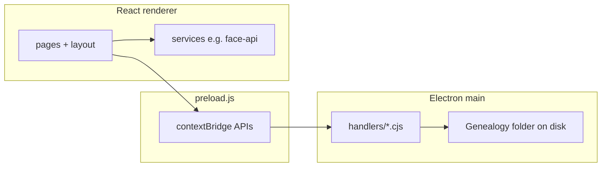
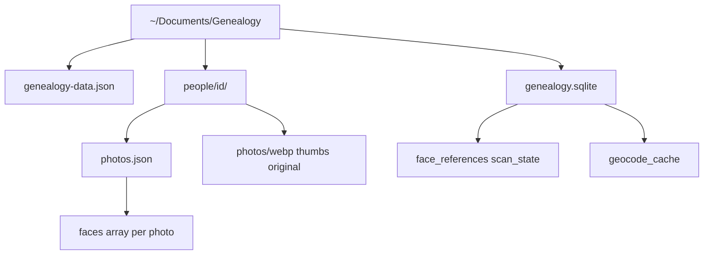
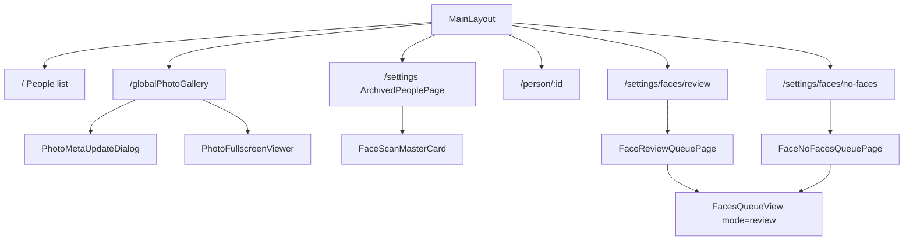
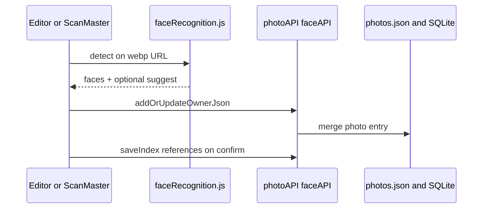

# Architecture (for agents)

## Runtime

- **Main**: file I/O, dialogs, Sharp, SQLite (`genealogy.sqlite` via `src/main/db/faceDb.cjs`), JSON under `~/Documents/Genealogy/` and `people/{id}/`.
- **Preload**: `photoAPI`, `peopleAPI`, `faceAPI`, `avatarAPI`, `appAPI`, … — no direct `fs` in renderer.
- **Renderer**: UI, `@vladmandic/face-api` (local models in `public/face-models/`).

## Data layout

- **People list**: `genealogy-data.json` (`schemaVersion` + `people`) — `dataStore.cjs`, atomic writes.
- **Per photo**: `photos.json` face record: `id`, `personId`, `box` (0–1), optional `descriptor`, `suggestedPersonId`, `suggestDistance`.
- **Face index (main)**: `genealogy.sqlite` — reference rows + batch scan state; **geocode** cache in the same DB. Renderer uses `faceAPI` (`face.cjs` → `faceDb.cjs`).
- **Legacy**: on first open, data from `face-index.json` is imported, file renamed to `face-index.migrated-*.json.bak`. Backup/import ZIP includes `genealogy.sqlite` (+ wal/shm).

## Navigation (high level)

- **Face queues** are full-page routes (not a global modal). Shared UI: `FacesQueueView.jsx`; thin wrappers set `mode`: `review` | `noFaces`.
- **Counters**: `useFaceReviewStore` (`pendingCount`, `noFacesCount`) — updated from `MainLayout` when photos load; entry from `FaceScanMasterCard` or notifications → `navigate("/settings/faces/...")`.

## Photos & faces flow

**Batch scan**: `FaceScanMasterCard` → `faceScanService.js` → `getAllGlobal` → detect/suggest → `addOrUpdateOwnerJson`.

**Review labels**: user opens `/settings/faces/review` → `FacesQueueView` (`mode="review"`) → confirm `personId` → `addOrUpdateOwnerJson` + `faceAPI.saveIndex` (SQLite references).

**Photos without faces**: `/settings/faces/no-faces` → `FacesQueueView` (`mode="noFaces"`) — queue for scanning/marking.

**Merge person IDs (IPC)**: `faceAPI.mergePersonIds` in `face.cjs` — use only when a UI flow calls it; no dedicated merge dialog in tree today.

## When you change architecture

Propose updates to this file in the same task; **get user approval** before editing (see `AGENTS.md`).
